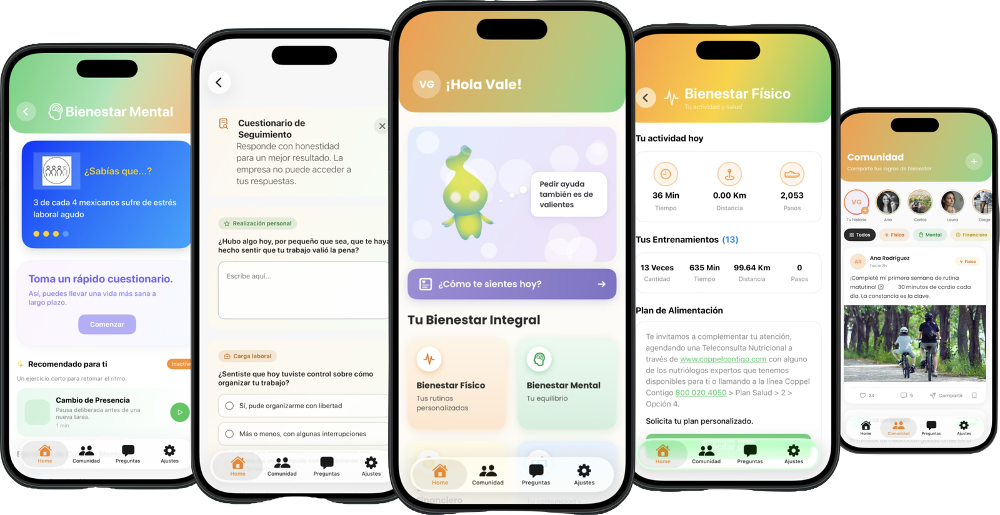
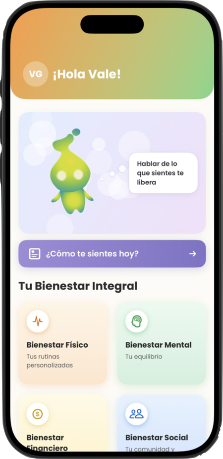
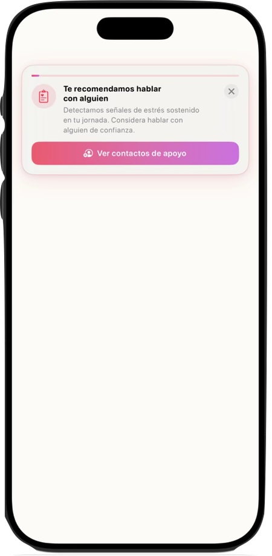
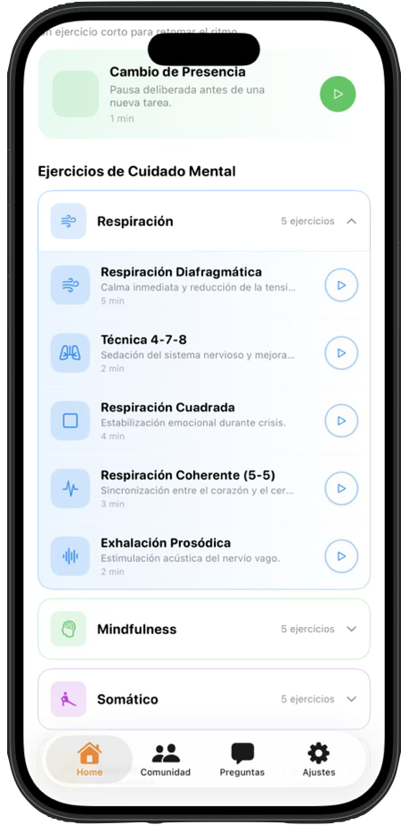
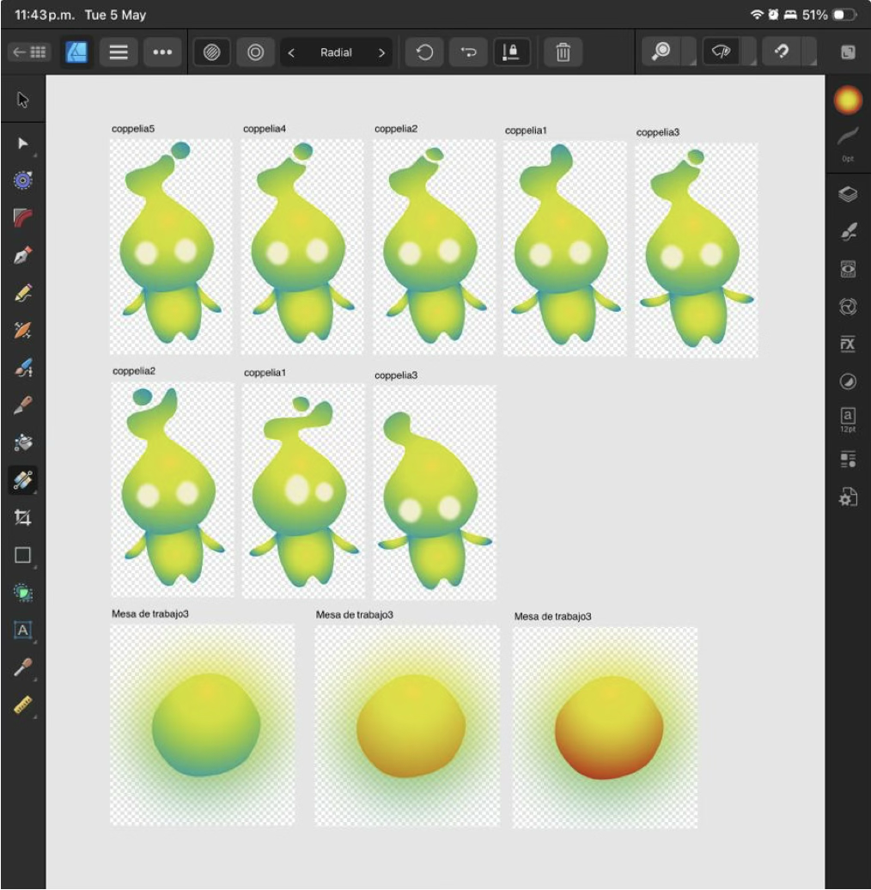

<div align="center">

[Español](README.md) | **English**


# BienIntCoppel

**Holistic well-being app for Coppel employees**


</div>

---

## Overview

BienIntCoppel is an iOS app that tracks the physical, mental, financial and social well-being of Coppel employees. Its main goal is to detect early signs of burnout through short questionnaires and, based on the results, offer exercises, recommendations and support channels.

The app features Copelia, an animated virtual assistant that appears on the home screen with well-being messages.

> **Privacy.** Responses are stored only on the user's device. The company has no access to them, and they are deleted when the app is uninstalled.

## Screenshots

<p align="center">
  
</p>

<table>
  <tr>
    <td align="center"><br /><b>Home</b></td>
    <td align="center"><br /><b>Risk alert</b></td>
    <td align="center"><br /><b>Mental care exercises</b></td>
  </tr>
</table>

### Copelia's design

Copelia was animated frame by frame: the app cycles through eight poses to simulate movement.

<p align="center">
  
</p>

> The app's interface is in Spanish.

## Features

### Home
- Copelia animation with rotating well-being messages.
- Shortcut to the daily questionnaire ("How do you feel today?").
- Holistic Well-being sections: Physical, Mental, Financial and Social.
- Carousel with internal Coppel news.
- Risk alert: when the analysis detects a high alert level, the app shows a notice recommending the user talk to someone and links to support contacts.

### Adaptive follow-up questionnaire
- Each session presents two questions from different burnout dimensions: workload, emotional exhaustion, depersonalization, personal accomplishment and physical indicators.
- Four answer formats: free text, multiple choice, multiple choice with icons, and icon scale.
- Question selection adapts to the user: it prioritizes the dimensions with the highest accumulated risk, avoids repeating recent questions and favors the formats the user answers most often.
- On devices that support Apple Intelligence, questions are generated on-device with Foundation Models. On other devices, a predefined question bank is used.

### Burnout pattern detection
The `PatternDetector` module analyzes the last seven questionnaires and combines:

- Risk score per dimension.
- Keywords in open-ended answers associated with depressive, fatigue and cynicism signals.
- Worsening trend and number of consecutive high-risk days.

It then assigns an alert level (normal, watch, warning or critical) and a dominant pattern: chronic fatigue, emotional exhaustion, depressive signs, depersonalization, physical deterioration or combined burnout.

### Mental well-being
- Informational cards about mental health.
- 20 mental care exercises in four categories:
  - **Breathing:** diaphragmatic, 4-7-8 technique, box breathing and coherent breathing (5-5), among others.
  - **Mindfulness:** 5-4-3-2-1 grounding and body scan, among others.
  - **Somatic:** progressive muscle relaxation and tapping (EFT), among others.
  - **Writing:** brain-dump journal, gratitude journal and strengths reframing, among others.
- Personalized recommendation: a Core ML model (`MentalWellnessClassifier`) classifies the user's profile (anxious, stable, inactive or advanced) based on their activity per category, active days and questionnaire score. If the model is unavailable, fallback rules are applied.

### Physical well-being
- Daily activity and workout summary.
- Meal plan with a request for a Nutritional Teleconsultation.
- Shortcuts to Coppel Contigo (phone guidance, ambulance service and financial support).
- Physical activity challenges and the "Échale los Kilos" program.

### Community
- Posts about well-being achievements, tips and reflections, with a photo and category.
- Reactions, comments and sharing.

### FAQ and settings
- Frequently asked questions about AI-based support, privacy and access to professional care.
- Notification, privacy and dark mode settings.

## Technologies

| Technology | Purpose |
|---|---|
| SwiftUI | Interface, animations and navigation |
| Foundation Models (Apple Intelligence) | On-device generation of personalized questions |
| Core ML | Profile classification for exercise recommendations |
| SwiftData and UserDefaults | Local persistence of questionnaires and interactions |
| Combine | Reactive state management |
| Poppins | Typeface |

## Project structure

```
BienIntCoppel/
├── BienIntCoppelApp.swift      Entry point
├── ContentView.swift           Main navigation: Home, Community, Questions, Settings
├── Views/                      App screens
├── Components/                 Reusable components (cards, banners, buttons, alerts)
├── Models/                     Question, questionnaire, recommendation and card models
├── Utils/                      Pattern detection, recommendation engine, AI tools,
│                               Core ML classifier and exercise catalog
└── Assets.xcassets/            Graphic assets
```

## Getting started

**Requirements**

- macOS with Xcode 26 or later.
- Simulator or iPhone running iOS 26 or later.
- AI-generated questions require a device that supports Apple Intelligence. Without it, the app uses the predefined question bank.

**Steps**

1. Clone the repository:
   ```bash
   git clone https://github.com/Abejandr4/BienIntCoppel.git
   ```
2. Open `BienIntCoppel.xcodeproj` in Xcode.
3. Select the `BienIntCoppel` scheme and a simulator or device.
4. Run with `Cmd + R`.

## Future work

- Financial Well-being and Social Well-being sections.
- Support contacts directory (`ContactosView`).
- Dynamic user profile to replace sample data.

## Authors

Developed by [Alejandra](https://github.com/Abejandr4), [Myrahis](https://github.com/MyrahisYSanluis), [Valentina](https://github.com/Valoo-1201). 
