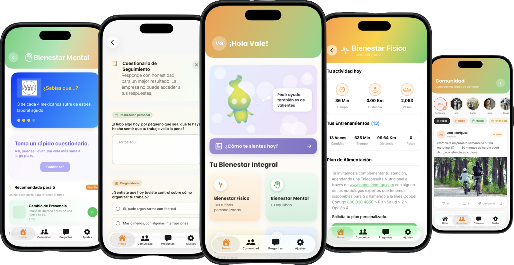
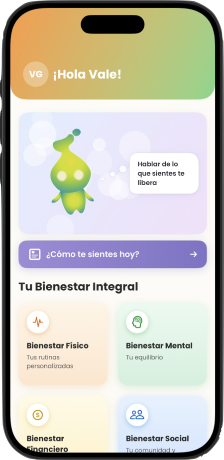
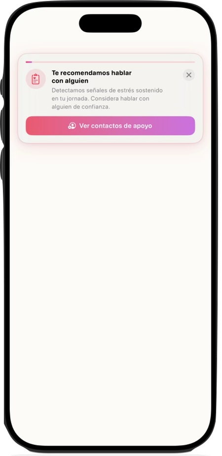
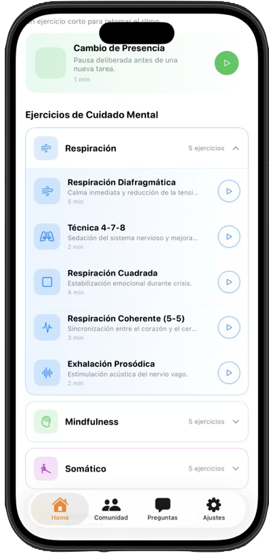
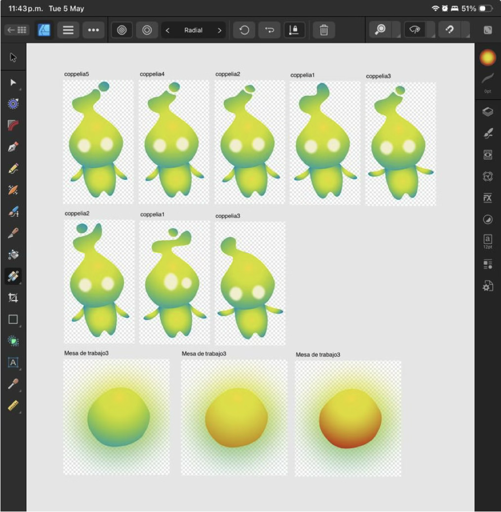

<div align="center">

**Español** | [English](README.en.md)


# BienIntCoppel

**Aplicación de bienestar integral para colaboradores de Coppel**


</div>

---

## Descripción

BienIntCoppel es una aplicación para iOS que da seguimiento al bienestar físico, mental, financiero y social de los colaboradores de Coppel. Su objetivo principal es identificar de forma temprana señales de agotamiento laboral (burnout) mediante cuestionarios breves y, a partir de los resultados, ofrecer ejercicios, recomendaciones y canales de apoyo.

La aplicación incluye a Copelia, una asistente virtual animada que aparece en la pantalla de inicio con mensajes de bienestar.

> **Privacidad.** Las respuestas se almacenan únicamente en el dispositivo del usuario. La empresa no tiene acceso a ellas, y se eliminan al desinstalar la aplicación.

## Capturas de pantalla

<p align="center">
  
</p>

<table>
  <tr>
    <td align="center"><br /><b>Inicio</b></td>
    <td align="center"><br /><b>Alerta de riesgo</b></td>
    <td align="center"><br /><b>Ejercicios de cuidado mental</b></td>
  </tr>
</table>

### Diseño de Copelia

La animación de Copelia se construyó cuadro por cuadro: la aplicación alterna ocho poses para simular movimiento.

<p align="center">
  
</p>

## Funcionalidades

### Inicio
- Animación de Copelia con mensajes de bienestar rotativos.
- Acceso directo al cuestionario diario ("¿Cómo te sientes hoy?").
- Secciones de Bienestar Integral: Físico, Mental, Financiero y Social.
- Carrusel de noticias internas de Coppel.
- Alerta de riesgo: cuando el análisis detecta un nivel de alerta elevado, la aplicación muestra un aviso que recomienda hablar con alguien y dirige a los contactos de apoyo.

### Cuestionario de seguimiento adaptativo
- Cada sesión presenta dos preguntas de dimensiones distintas del burnout: carga laboral, agotamiento emocional, despersonalización, realización personal e indicadores físicos.
- Cuatro formatos de respuesta: texto libre, opción múltiple, opción múltiple con íconos y escala de íconos.
- La selección de preguntas se adapta al usuario: prioriza las dimensiones con mayor riesgo acumulado, evita repetir preguntas recientes y favorece los formatos que el usuario responde con más frecuencia.
- En dispositivos compatibles con Apple Intelligence, las preguntas se generan localmente con Foundation Models. En los demás dispositivos se utiliza un banco de preguntas predefinido.

### Detección de patrones de burnout
El módulo `PatternDetector` analiza los últimos siete cuestionarios y combina:

- Puntaje de riesgo por dimensión.
- Palabras clave en las respuestas abiertas asociadas a señales depresivas, de fatiga y de cinismo.
- Tendencia de empeoramiento y número de días consecutivos con riesgo alto.

Como resultado asigna un nivel de alerta (normal, observación, advertencia o crítico) y un patrón dominante: fatiga crónica, agotamiento emocional, señales depresivas, despersonalización, deterioro físico o burnout combinado.

### Bienestar mental
- Tarjetas informativas sobre salud mental.
- 20 ejercicios de cuidado mental organizados en cuatro categorías:
  - **Respiración:** diafragmática, técnica 4-7-8, respiración cuadrada y coherente (5-5), entre otras.
  - **Mindfulness:** grounding 5-4-3-2-1 y escaneo corporal, entre otras.
  - **Somáticos:** relajación muscular progresiva y tapping (EFT), entre otras.
  - **Escritura:** diario de vaciado, diario de gratitud y reencuadre de fortalezas, entre otras.
- Recomendación personalizada: un modelo de Core ML (`MentalWellnessClassifier`) clasifica el perfil del usuario (ansioso, estable, inactivo o avanzado) a partir de su interacción por categoría, sus días activos y el resultado del cuestionario. Si el modelo no está disponible, se aplican reglas de respaldo.

### Bienestar físico
- Resumen de actividad diaria y entrenamientos.
- Plan de alimentación con solicitud de Teleconsulta Nutricional.
- Accesos directos a Coppel Contigo (orientación telefónica, servicio de ambulancia y apoyo económico).
- Retos de actividad física y el programa "Échale los Kilos".

### Comunidad
- Publicaciones de logros, consejos y reflexiones de bienestar, con fotografía y categoría.
- Reacciones, comentarios y opción para compartir.

### Preguntas frecuentes y ajustes
- Preguntas frecuentes sobre el acompañamiento con inteligencia artificial, la privacidad y el acceso a atención profesional.
- Configuración de notificaciones, privacidad y modo oscuro.

## Tecnologías

| Tecnología | Uso |
|---|---|
| SwiftUI | Interfaz, animaciones y navegación |
| Foundation Models (Apple Intelligence) | Generación local de preguntas personalizadas |
| Core ML | Clasificación del perfil para recomendar ejercicios |
| SwiftData y UserDefaults | Persistencia local de cuestionarios e interacciones |
| Combine | Manejo de estado reactivo |
| Poppins | Tipografía |

## Estructura del proyecto

```
BienIntCoppel/
├── BienIntCoppelApp.swift      Punto de entrada
├── ContentView.swift           Navegación principal: Inicio, Comunidad, Preguntas, Ajustes
├── Views/                      Pantallas de la aplicación
├── Components/                 Componentes reutilizables (tarjetas, banners, botones, alertas)
├── Models/                     Modelos de preguntas, cuestionarios, recomendaciones y tarjetas
├── Utils/                      Detección de patrones, motor de recomendación, herramientas de IA,
│                               clasificador de Core ML y catálogo de ejercicios
└── Assets.xcassets/            Recursos gráficos
```

## Instalación y ejecución

**Requisitos**

- macOS con Xcode 26 o posterior.
- Simulador o iPhone con iOS 26 o posterior.
- Para la generación de preguntas con inteligencia artificial se requiere un dispositivo compatible con Apple Intelligence. Sin él, la aplicación funciona con el banco de preguntas predefinido.

**Pasos**

1. Clonar el repositorio:
   ```bash
   git clone https://github.com/Abejandr4/BienIntCoppel.git
   ```
2. Abrir `BienIntCoppel.xcodeproj` en Xcode.
3. Seleccionar el esquema `BienIntCoppel` y un simulador o dispositivo.
4. Ejecutar con `Cmd + R`.

## Trabajo futuro

- Desarrollo de las secciones de Bienestar Financiero y Bienestar Social.
- Directorio de contactos de apoyo (`ContactosView`).
- Perfil de usuario dinámico en sustitución de los datos de ejemplo.

## Autores

Desarrollado por [Alejandra](https://github.com/Abejandr4), [Myrahis](https://github.com/MyrahisYSanluis), [Valentina](https://github.com/Valoo-1201). 
